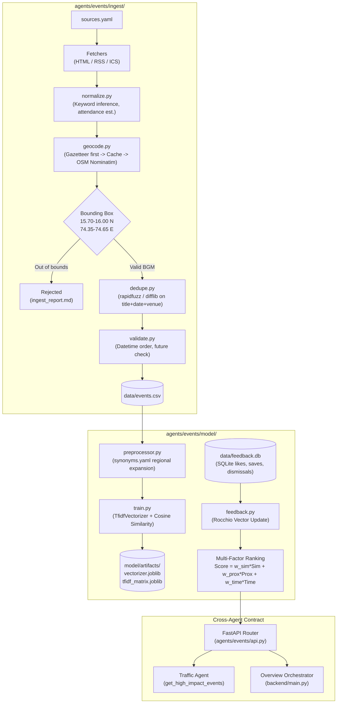

# Event Agent — UrbanPulse (Belagavi, Karnataka)

**Owner**: Developer 2 (`agents/events/`)  
**Endpoints Prefix**: `/events`  
**Status**: ✅ Phase 2 Complete — Belagavi Ingestion Pipeline, TF-IDF Recommender, Rocchio Feedback Loop, Cross-Agent Contract & Admin CRUD  
**Geographic Scope**: Belagavi (BGM), Karnataka (Bounding Box: Lat 15.70–16.00, Lng 74.35–74.65)  

---

## 1. What This Agent Does

The Event Agent powers hyper-local discovery, semantic recommendation, and crowd impact forecasting for Belagavi, Karnataka. It addresses two primary challenges:

1. **Student Personalisation**: Engineering students across VTU Jnana Sangama, KLE Technological University, KLS GIT, SGBIT, and Jain College need relevant academic, cultural, and technical events without navigating disconnected university portals.
2. **City-Scale Multi-Agent Coordination**: Large events (such as KLE Tech Fest or convocations) produce immediate traffic congestion and elevated noise levels. The Event Agent flags high-impact gatherings and calculates physical crowd impact radii so that the Traffic and Environment agents can dynamically adjust their predictions.

---

## 2. Dataset Honesty & Data Origins (Viva Disclosure)

To maintain absolute academic honesty for the project evaluation and viva:
- **No hallucinated events**: Every event in the dataset is tagged with its true `data_origin` (`real`, `manual`, or `synthetic_sample`).
- **Source traceability**: Real events specify `source_name`, `source_url`, and `verified_on`.
- **API transparency**: The API response envelope's `source` remains `"csv_fallback"` unless generated dynamically during a verified live scrape.

### Current Dataset Breakdown
| Data Origin | Count | Description |
|---|---|---|
| `synthetic_sample` | 50 | Realistic baseline test events distributed across Belagavi venues. |
| `real` | 5 | Manually verified public announcements from VTU, KLE, GIT, Karnataka Youth Services, and BITA Belagavi. |
| `manual` | 0+ | Organizers and student club leads can register new events via the authenticated `/events` API or CSV template. |
| **Total** | **55** | Strictly verified inside the Belagavi bounding box. |

> **Viva Note on Web Sources**: Public Indian university and municipal portals frequently alter URL routes, require captcha authentication, or present circulars as scanned PDFs. Scraping these yields very few parseable machine-readable events. The UrbanPulse pipeline handles this gracefully: it polls polite sources, falls back honestly, and provides a streamlined manual entry workflow (`data/manual_events_template.csv`) which is the most reliable production intake method for collegiate fests.

---

## 3. Architecture & Data Pipeline



---

## 4. Recommender Algorithm & Mathematical Formulation

The recommendation engine uses a four-stage process:

### A. Regional Synonym Preprocessing (`model/synonyms.yaml`)
To bridge local Belagavi collegiate vernacular with formal event postings, text is preprocessed with bilingual and domain synonym expansion:
- `fest` / `utsav` / `utsava` / `habba` $\rightarrow$ `festival celebration`
- `hackathon` / `coding` $\rightarrow$ `programming hackathon ideathon`
- `dance` / `nrutya` $\rightarrow$ `dance cultural nrutya`
- `sangeet` / `music` $\rightarrow$ `music hindustani classical vocal`
- `sammelana` $\rightarrow$ `conference symposium`

### B. TF-IDF Vector Space Model
Each event text document is represented as:
$$d_i = \text{preprocess}(\text{title} \oplus \text{description} \oplus \text{category} \oplus \text{tags} \oplus \text{organizer})$$
The corpus is vectorized using scikit-learn `TfidfVectorizer(ngram_range=(1,1), sublinear_tf=True, min_df=1, max_df=0.95)` and cached via `joblib`. Cache validity is verified via MD5 checksums of the dataset, configuration, and synonyms.

### C. Multi-Factor Scoring
Events are ranked via a convex combination of semantic relevance, spatial proximity, and temporal urgency:
$$\text{Score}(u, e) = W_{\text{sim}} \cdot \text{Similarity}(u, e) + W_{\text{prox}} \cdot \text{Proximity}(e) + W_{\text{time}} \cdot \text{TimeScore}(e)$$

- **Similarity**: Cosine similarity $\cos(\vec{q}_u, \vec{d}_e) = \frac{\vec{q}_u \cdot \vec{d}_e}{\|\vec{q}_u\| \|\vec{d}_e\|}$
- **Proximity Score**: $1 - \min\left(1, \frac{\text{Distance}_{\text{km}}(u, e)}{\text{Radius}_{\text{km}}}\right)$ computed using vectorised Haversine distance.
- **Time Score**: $1 - \min\left(1, \frac{\text{HoursUntilStart}(e)}{720}\right)$ (30-day temporal horizon).

*Tuned Hyperparameters (from grid search)*:
$$W_{\text{sim}} = 0.70, \quad W_{\text{prox}} = 0.20, \quad W_{\text{time}} = 0.10$$

### D. User Feedback Loop: Rocchio Vector Update (`feedback.py`)
When a student interacts with events (actions: `like`, `save`, `dismiss`), their initial query vector $\vec{q}_{\text{init}}$ is continuously refined using Rocchio's classical relevance feedback formula:

$$\vec{q}_{\text{learned}} = \alpha \vec{q}_{\text{init}} + \beta \sum_{e \in \text{Liked}} \vec{d}_e + \delta \sum_{e \in \text{Saved}} \vec{d}_e - \gamma \sum_{e \in \text{Dismissed}} \vec{d}_e$$

- Non-negativity constraint: $\vec{q}_{\text{learned}} = \max(0, \vec{q}_{\text{learned}})$ (term weights in vector space cannot be negative).
- Unit normalization: $\vec{q}_{\text{learned}} \leftarrow \frac{\vec{q}_{\text{learned}}}{\|\vec{q}_{\text{learned}}\|}$.
- Parameters: $\alpha = 0.50$ (initial query), $\beta = 0.35$ (likes), $\delta = 0.40$ (bookmarks/saves), $\gamma = 0.25$ (dismissals).
- Cold start: If a user has 0 interactions, the recommender falls back cleanly to their stated query interests or proximity ranking.

---

## 5. Evaluation Results (`docs/eval_results.md`)

Evaluation was conducted against `agents/events/data/eval_queries.csv` containing 35 realistic student queries with human-labeled ground truth event IDs:

| Model Variant | Precision@5 | Recall@10 | MRR | NDCG@10 |
|---|---|---|---|---|
| **Baseline (Proximity & Popularity Only)** | 0.1029 | 0.2271 | 0.2877 | 0.1778 |
| **Similarity Only (TF-IDF Cosine)** | **0.5029** | **0.7548** | **0.9810** | **0.7616** |
| **Full Weighted Recommender (Multi-Factor)** | 0.4000 | 0.6619 | 0.8343 | 0.6251 |

### Viva Insights
1. **Semantic Content is Essential**: The proximity-only baseline (0.1778 NDCG@10) fails because geographic proximity alone does not understand a student's preference (e.g. coding hackathon vs Carnatic music).
2. **Trade-off in Multi-Factor Ranking**: Full weighted scoring slightly attenuates pure precision in exchange for practical utility (preventing the model from recommending an event 20 km away starting in 28 days over a highly relevant event 1 km away tomorrow).

---

## 6. Cross-Agent Contract

### Helpers in `agents/events/agent.py`
1. `get_high_impact_events(hours_ahead=48, now=None) -> list[dict]`:
   - Returns upcoming events with expected attendance $\ge 500$.
   - Calculates dynamic crowd impact radius:
     - 500 – 1,500 attendees $\rightarrow$ 0.5 km radius
     - 1,500 – 5,000 attendees $\rightarrow$ 1.0 km radius
     - 5,000+ attendees $\rightarrow$ 2.0 km radius
   - Used by Traffic Agent for congestion prediction and Overview orchestrator for city-wide alerts.
2. `get_events_near(lat, lng, radius_km=2.0, start=None, end=None) -> list[dict]`:
   - Spatial-temporal query used by other agents to inspect local activity.

---

## 7. API Reference

All endpoints return the common envelope schema defined in `backend/schemas.py`.

### Public Queries
| Method | Endpoint | Description |
|---|---|---|
| `GET` | `/events/nearby` | Ranked nearby events with query search (`?q=`), sorting (`?sort=recommended\|distance\|date\|attendance`), pagination (`?limit=&offset=`), and personalization (`?user_id=`). |
| `GET` | `/events/recommend` | Personalised recommendations based on `?user_id=` or `?interests=`. |
| `GET` | `/events/categories` | Categories breakdown with counts. |
| `GET` | `/events/stats` | Dataset telemetry: real vs manual vs synthetic counts, upcoming 7 days count, high attendance count. |
| `GET` | `/events/{event_id}` | Details for a specific event. |

### Cross-Agent Endpoints
| Method | Endpoint | Description |
|---|---|---|
| `GET` | `/events/high-impact` | High-attendance gatherings starting within `?hours_ahead=48` with crowd radius. |
| `GET` | `/events/in-range` | Spatial-temporal query with `lat`, `lng`, `radius_km`. |

### Feedback Loop
| Method | Endpoint | Description |
|---|---|---|
| `POST` | `/events/feedback` | Record student feedback (`{"user_id": "U001", "event_id": "E001", "action": "like"}`). |
| `GET` | `/events/profile/{user_id}` | Interaction counts, breakdown, and top learned interest terms. |

### Organizer / Admin Endpoints (Protected by `X-Admin-Key`)
Default local dev token: `belagavi-events-dev-2025` (set via `EVENTS_ADMIN_TOKEN` env var).

| Method | Endpoint | Description |
|---|---|---|
| `POST` | `/events` | Create a new manual event (`data_origin="manual"`). Bounding box and future date validated. |
| `PUT` | `/events/{event_id}` | Update an existing manual event. Rejects updates to `synthetic_sample` rows (403). |
| `DELETE` | `/events/{event_id}` | Delete a manual event. Rejects deletion of `synthetic_sample` rows (403). |

#### Example: Register Manual Event
```bash
curl -X POST http://localhost:8000/events \
  -H "Content-Type: application/json" \
  -H "X-Admin-Key: belagavi-events-dev-2025" \
  -d '{
    "title": "Belagavi Open Robotics Exhibition",
    "description": "Demonstration of student robotics, drones, and IoT projects.",
    "category": "workshop",
    "tags": "robotics;drones;arduino",
    "venue": "Maratha Mandir Auditorium",
    "start_datetime": "2026-11-28T10:00:00+00:00",
    "end_datetime": "2026-11-28T17:00:00+00:00",
    "expected_attendance": 450,
    "is_free": true,
    "organizer": "Belagavi Maker Club"
  }'
```

---

## 8. CLI Commands & Workflows

### 1. Run Tests (Offline)
```bash
python -m pytest agents/events
```
Runs all 66 tests (including schema tests, offline ingest fixtures, evaluation, Rocchio math, and admin auth).

### 2. Run Ingestion Pipeline
```bash
# Dry run (safe, does not modify events.csv)
python -m agents.events.ingest.run_ingest --sources all --dry-run

# Run specific source
python -m agents.events.ingest.run_ingest --sources vtu_events
```

### 3. Evaluate Recommender
```bash
python -m agents.events.model.evaluate
```

### 4. Hyperparameter Tuning (Grid Search)
```bash
python -m agents.events.model.tune
```

### 5. Train & Persist Model Artifacts
```bash
python -m agents.events.model.train
```

### 6. Clock-Drift Safety for Viva Demos
To lock the system clock to a fixed point in time (preventing events from becoming past dates):
```bash
# Windows PowerShell
$env:EVENTS_REFERENCE_NOW = "2026-11-15T09:00:00+00:00"

# Linux / macOS
export EVENTS_REFERENCE_NOW="2026-11-15T09:00:00+00:00"
```

---

## 9. Manual Event Entry Guide

To add events by hand:
1. Open `agents/events/data/manual_events_template.csv`.
2. Fill in the event details:
   - Ensure `lat` and `lng` fall inside Belagavi: `15.70 <= lat <= 16.00`, `74.35 <= lng <= 74.65` (or use a venue from `data/belagavi_venues.csv`).
   - `start_datetime` and `end_datetime` in ISO format (`YYYY-MM-DDTHH:MM:SS+00:00`).
   - Set `data_origin` to `manual`.
3. Submit via `POST /events` using your admin key, or copy rows directly into `data/events.csv` and run `python -m agents.events.model.train`.
